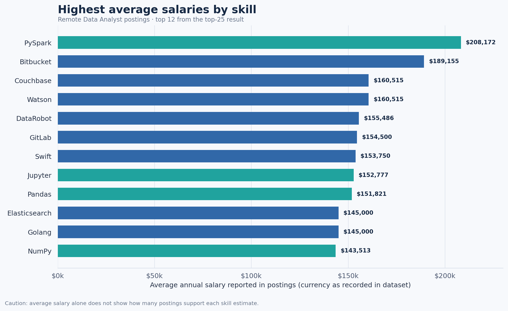
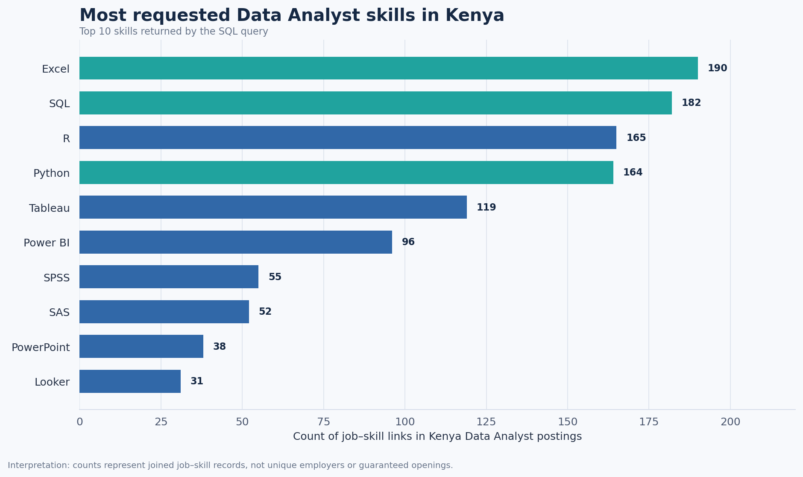
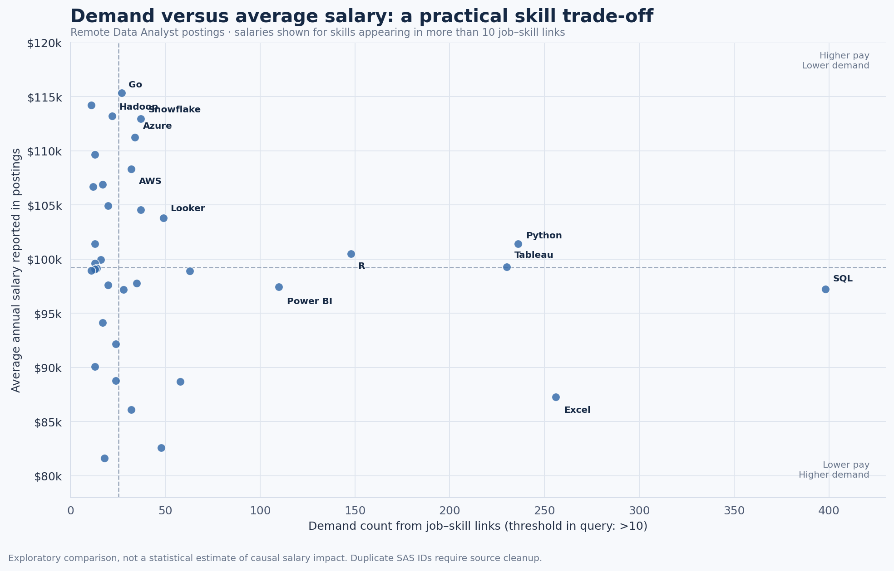

# SQL Job Market Analysis: Data Analyst Roles, Skills, and Salary
## Introduction

This project uses SQL to investigate the Data Analyst job market through three connected questions: **which roles advertise the highest salaries, which skills appear most often, and which skills combine meaningful demand with comparatively strong pay?** I also examine a Kenya-specific demand result so that the analysis has a local career-planning perspective alongside the remote-job salary results.

## Background and business questions

 A tool can appear frequently in vacancies without being associated with the highest reported salaries; another tool can have a high average salary but appear in relatively few postings. Looking at only one ranking can therefore produce a misleading learning plan.

I structured the analysis around five questions:

1. Which Data Analyst postings marked as `Anywhere` have the highest reported annual salaries?
2. Which skills are associated with the highest average annual salaries among remote Data Analyst postings?
3. Which skills appear most frequently in Kenya-based Data Analyst postings?
4. Which skills show a potentially useful balance between salary and demand in remote postings?
5. What skills are listed in the ten highest-paying Data Analyst postings?

## Tools I used

- **PostgreSQL** — filtering, joining tables, aggregation, ranking, and date conversion.
- **SQL** — `INNER JOIN`, `LEFT JOIN`, `WHERE`, `GROUP BY`, `HAVING`, `COUNT`, `AVG`, `ROUND`, `ORDER BY`, `LIMIT`, and a common table expression (`WITH`).
- **Visual Studio Code** — writing and organising the `.sql` files.
- **Git and GitHub** — version control and publishing the project.

## Analysis

### 1. Highest-paying Data Analyst jobs

**Source query:** [`top_paying_jobs.sql`](project_folder/top_paying_jobs.sql)  
**Question:** Which ten Data Analyst job postings marked `Anywhere` have the highest non-null reported annual salary?

```sql
SELECT
    job_title_short,
    job_posted_date::date,
    salary_year_avg,
    job_location,
    name AS company_name
FROM job_postings_fact
LEFT JOIN company_dim
    ON job_postings_fact.company_id = company_dim.company_id
WHERE
    job_title_short = 'Data Analyst'
    AND salary_year_avg IS NOT NULL
    AND job_location = 'Anywhere'
ORDER BY salary_year_avg DESC
LIMIT 10;
```

**Why this query matters:** It establishes a view of the highest-paid postings in the selected segment. The `LEFT JOIN` adds company names where a matching company record exists, while the filter excludes missing salary values and non-Data-Analyst titles.I limited the results to 10 rows.

 ### Top-Paying Data Analyst Jobs

The query identifies the ten highest-paying Data Analyst job postings with a location listed as `Anywhere` and a non-null annual salary. The results are ordered by average annual salary in descending order.


| Rank | Job Title | Company | Average Annual Salary (USD) |
|---:|---|---|---:|
| 1 | Data Analyst | Mantys | $650,000 |
| 2 | Data Analyst | Meta | $336,500 |
| 3 | Data Analyst | AT&T | $255,829.50 |
| 4 | Data Analyst | Pinterest Job Advertisements | $232,423 |
| 5 | Data Analyst | Uclahealthcareers | $217,000 |
| 6 | Data Analyst | SmartAsset | $205,000 |
| 7 | Data Analyst | Inclusively | $189,309 |
| 8 | Data Analyst | Motional | $189,000 |
| 9 | Data Analyst | SmartAsset | $186,000 |
| 10 | Data Analyst | Get It Recruit - Information Technology | $184,000 |

**Key Insights**

- **Highest salary:** Mantys leads the results with an annual salary of $650,000, followed by Meta at $336,500.
- **Salary variation:** The listed salaries range from $184,000 to $650,000, highlighting substantial differences in compensation among the top ten postings.
- **Repeated employer:** SmartAsset appears twice, with salaries of $205,000 and $186,000.
- **Remote opportunities:** All ten postings match the `Anywhere` location filter, indicating that the dataset classifies these opportunities as location-independent.
- **Important limitation:** These are historical

### 2. Skills associated with the highest average salaries

**Source query:** [`top_paying_skills.sql`](project_folder/top_paying_skills.sql)  
**Question:** Among remote Data Analyst postings with a reported annual salary, which skills have the highest average salaries?

```sql
SELECT
    skills,
    ROUND(AVG(salary_year_avg), 0) AS avg_salary
FROM job_postings_fact
INNER JOIN skills_job_dim
    ON job_postings_fact.job_id = skills_job_dim.job_id
INNER JOIN skills_dim
    ON skills_job_dim.skill_id = skills_dim.skill_id
WHERE
    job_title_short = 'Data Analyst'
    AND salary_year_avg IS NOT NULL
    AND job_work_from_home = TRUE
GROUP BY skills
ORDER BY avg_salary DESC
LIMIT 25;
```

#### Visual: highest average salary by skill




*Salary formatting uses the dollar values reported in the source dataset; confirm the dataset's currency definition when adding the source citation.*

**What the results suggest:** PySpark leads the returned list at $208,172, followed by Bitbucket at $189,155. Data-processing and infrastructure-related tools such as PySpark, Databricks, Airflow, Kubernetes, and cloud platforms also appear. This may indicate that some higher-paying postings require analysts to work closer to data engineering or production data systems.


### 3. Most requested Data Analyst skills in Kenya

**Source query:** [`top_demand_skills.sql`](project_folder/top_demand_skills.sql)  
**Question:** Which skills are most frequently linked to Data Analyst postings located in Kenya?

```sql
SELECT
    skills,
    COUNT(skills_job_dim.job_id) AS demand_count
FROM job_postings_fact
INNER JOIN skills_job_dim
    ON job_postings_fact.job_id = skills_job_dim.job_id
INNER JOIN skills_dim
    ON skills_job_dim.skill_id = skills_dim.skill_id
WHERE
    job_country = 'Kenya'
    AND job_title_short = 'Data Analyst'
GROUP BY skills
ORDER BY demand_count DESC
LIMIT 10;
```

#### Visual: local skill demand



#### Results

**Key observation:** Excel and SQL lead the Kenya result with counts of 190 and 182, followed by R and Python at 165 and 164. Tableau and Power BI also appear prominently, which supports building a practical toolkit across data handling, querying, statistical analysis, and presenting results.

### 4. Skills with a demand–salary trade-off

**Source query:** [`top_optimal_skills.sql`](project_folder/top_optimal_skills.sql)  
**Question:** Among remote Data Analyst postings with salary data, which skills have both a usable number of linked job records and comparatively high average salaries?

The query in the project filters to salary records, remote work, Data Analyst roles, and skills with more than ten linked job records. It then sorts by average salary, with demand as a secondary sort.

```sql
SELECT
    skills_dim.skill_id,
    skills_dim.skills,
    COUNT(skills_job_dim.job_id) AS demand_count,
    ROUND(AVG(salary_year_avg), 0) AS avg_salary
FROM job_postings_fact
INNER JOIN skills_job_dim
    ON job_postings_fact.job_id = skills_job_dim.job_id
INNER JOIN skills_dim
    ON skills_job_dim.skill_id = skills_dim.skill_id
WHERE
    salary_year_avg IS NOT NULL
    AND job_title_short = 'Data Analyst'
    AND job_work_from_home = TRUE
GROUP BY skills_dim.skill_id
HAVING COUNT(skills_job_dim.job_id) > 10
ORDER BY
    avg_salary DESC,
    demand_count DESC;
```

#### Visual: salary versus demand




### 5. Skills appearing in the highest-paying jobs

**Source query:** [`top_paying_job_skills.sql`](project_folder/top_paying_job_skills.sql)  
**Question:** Which skills are listed in the ten highest-paying remote-style Data Analyst postings selected by the first query?

```sql
WITH top_paying_jobs AS (
    SELECT
        job_postings_fact.job_id,
        job_title,
        salary_year_avg,
        name AS company_name
    FROM job_postings_fact
    LEFT JOIN company_dim
        ON job_postings_fact.company_id = company_dim.company_id
    WHERE
        job_title_short = 'Data Analyst'
        AND salary_year_avg IS NOT NULL
        AND job_location = 'Anywhere'
    ORDER BY salary_year_avg DESC
    LIMIT 10
)
SELECT
    top_paying_jobs.*,
    skills
FROM top_paying_jobs
INNER JOIN skills_job_dim
    ON top_paying_jobs.job_id = skills_job_dim.job_id
INNER JOIN skills_dim
    ON skills_job_dim.skill_id = skills_dim.skill_id
ORDER BY salary_year_avg DESC;
```

This uses a CTE to select the ten postings first, then joins those job IDs to the skills tables. Selecting `job_id` inside the CTE is essential because the outer query can reference only the columns exposed by `top_paying_jobs`, not the original `job_postings_fact` table by its former name

## What I learnt

1. Joining tables adds business context: Job postings provide job details, company tables identify employers, and skills tables reveal the skills required.
2. CTEs simplify complex queries: They allow you to isolate the ten highest-paying jobs before retrieving their associated skills.
3. Understand the grain of your data: Joining jobs to skills creates job–skill rows, so counting rows differs from counting distinct job postings.
4. Filters and data quality matter: Use precise filters, check duplicate skill labels and IDs, and verify sample sizes before interpreting salary rankings.
5. Turn analysis into decisions: Explain what the results suggest, acknowledge their limitations, and recommend practical next steps rather than presenting queries alone.

## Conclusions, insights, and closing thoughts

The strongest practical takeaway from the provided outputs is to **build a foundation before chasing salary outliers**. In the Kenya demand result, Excel and SQL are the two most frequently linked skills, with R and Python close behind. In the remote salary-and-demand result, SQL, Python, Excel, Tableau, and Power BI have substantial counts, while platforms such as Snowflake, Azure, and AWS appear at comparatively high average salaries in a smaller subset.


1. **Build the foundation:** Excel and SQL for data preparation, querying, validation, and analysis.
2. **Learn to communicate findings:** Power BI or Tableau, with attention to business questions and clear reporting.
3. **Add analytical depth:** Python or R for repeatable analysis and automation.
4. **Specialise when the target role justifies it:** cloud platforms, distributed data tools, or orchestration tools such as Snowflake, Azure, AWS, PySpark, or Airflow.